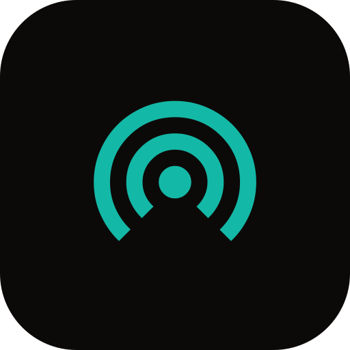

<p align="center"></p>

<h1 align="center">2n5a</h1>

<p align="center">V2Ray / Xray VPN + Wi-Fi/USB hotspot sharing over Shizuku — native Android (Kotlin, Compose).</p>

2n5a is [Shizzi](https://github.com/carlelieser/shizzi) v0.5.0 (hotspot sharing through a
Shizuku-privileged test network) with a real V2Ray/Xray VPN added and a new Arabic RTL interface.
**Application ID and package are unchanged (`dev.shizzi`)**, as are Shizuku, the hotspot logic and
the Go datapath.

## What it does

- **VPN:** paste a `vless://`, `vmess://`, `trojan://` or `ss://` link (or a base64 subscription),
  save it, tap *تشغيل VPN*. Runs Xray in-process; no external core, no JitPack.
- **Hotspot through the VPN:** Shizzi's *Follow VPN* mode finds the 2n5a tunnel and pins hotspot
  traffic to it. Modes: follow automatically / refuse sharing without a VPN / ignore the VPN.
- Reality, TLS, WebSocket, gRPC, HTTPUpgrade, XHTTP transports. See *Limits* below.

## Requirements

Android 11+ (API 30), arm64, [Shizuku](https://shizuku.rikka.app/) 13.6.0+ for sharing.
The VPN alone does not need Shizuku.

## Build

The project root is the Gradle root. Do **not** open a subfolder.

```
# once
go install golang.org/x/mobile/cmd/gomobile@latest && gomobile init
# Go 1.27+, Android SDK, NDK 27.0.12077973

./gradlew assembleDebug        # first build runs `go mod tidy` to resolve Xray (needs network)
./gradlew testDebugUnitTest
```

Easiest path: push to GitHub and let **Actions → Build** produce `2n5a-debug-apk`
(`.github/workflows/build.yml`). It installs Go 1.27, the NDK and gomobile for you.

## Layout

| Path | Role |
|---|---|
| `app/src/main/java/dev/shizzi/vpn/` | **new** — link parser, Xray config builder, `XrayVpnService`, server storage |
| `app/src/main/java/dev/shizzi/ui/twon5a/` | **new** — Arabic RTL home + settings screens |
| `datapath/xray.go` | **new** — embeds Xray, `StartXray` / `StartVpn` / `SetProtector` |
| `datapath/forward.go`, `datapath.go` | Shizzi, minimally refactored (`flowDialer` seam, shared `buildStack`) |
| everything else | Shizzi, unchanged |

Architecture and the integration map: [docs/2n5a-architecture.md](docs/2n5a-architecture.md).

## Limits

- Xray v26 removed the **HTTP/2 (`h2`)** and **QUIC** transports. Links using them are rejected with a
  clear message; ask the provider for XHTTP, WebSocket or gRPC.
- mKCP and Shadowsocks plugins are not supported.
- arm64 only (inherited from Shizzi's `abiFilters`).
- The server ping is a TCP connect time, not a proxy handshake.

Licenses: Shizzi and 2n5a additions follow the upstream repository's license; Cairo font is SIL OFL
(`app/src/main/assets/licenses/cairo-OFL.txt`); Xray-core is MPL-2.0.
